<a id="toc"></a>
## 目次

- [図の見方](#legend)
- [int_testcase](#int_testcase): 整数のパース
  - [01.txt](#int_testcase-01): nb_drones の全角・`+`・`_`・先頭のゼロ
  - [02.txt](#int_testcase-02): nb_drones の 0・負・小数・余分な値
  - [03.txt](#int_testcase-03): 座標
  - [04.txt](#int_testcase-04): max_drones
  - [05.txt](#int_testcase-05): max_link_capacity
- [color_testcase](#color_testcase): 色の値
  - [01〜05.txt](#color_testcase-01-05): 配られた地図にある名前、同じ形の名前
  - [06〜10.txt](#color_testcase-06-10): 大文字・ASCII 以外・数字・アンダースコア
  - [11〜16.txt](#color_testcase-11-16): ダッシュ・none・指定なし・`#`・空・2 語
  - [17〜18.txt](#color_testcase-17-18): 接続に色
  - [19.txt](#color_testcase-19): ログに色の制御文字が混ざらないか
- [prove_priority](#prove_priority): priority の扱い
  - [01〜06.txt](#prove_priority-01-06): 5 本の分岐のうち priority が 1〜2 本
- [prove_restricted](#prove_restricted): restricted の規則
  - [01〜05.txt](#prove_restricted-01-05): 接続の空き方、着く先が満杯、2 つ続く
  - [06.txt](#prove_restricted-06): PDF 9 ページの例の地図
- [prove_follow_through](#prove_follow_through): 出て行く分は同じターンで空く
  - [01〜02.txt](#prove_follow_through-01-02): 一本道で、出る分が同じターンに空くか
- [prove_capacity](#prove_capacity): ゾーンと接続の容量
  - [01〜04.txt](#prove_capacity-01-04): 容量の既定値、容量 2、start と end
- [prove_cost](#prove_cost): 移動のコストを考えた経路
  - [01〜03.txt](#prove_cost-01-03): restricted の遠回り・近道、blocked の迂回
- [prove_unreachable](#prove_unreachable): start から end へ行けない地図
  - [01〜05.txt](#prove_unreachable-01-05): 行けない地図、start や end が blocked
- [many_drones](#many_drones): ドローンが非常に多いとき
  - [01〜03.txt](#many_drones-01-03): 100・1000・10000 台
  - [04〜05.txt](#many_drones-04-05): 1 台と 10 億台
- [no_traceback](#no_traceback): ファイルそのものの異常
  - [01.txt](#no_traceback-01): 空のファイル
  - [02.txt](#no_traceback-02): コメントしか無い
  - [03.txt](#no_traceback-03): UTF-8 でない
  - [04.txt](#no_traceback-04): BOM
  - [05.txt](#no_traceback-05): CRLF
  - [06.txt](#no_traceback-06): バイナリ
  - [07.txt](#no_traceback-07): 読む権限が無い
  - [08.txt](#no_traceback-08): 最後に改行が無い
- [parse_format](#parse_format): 空白・記号・大文字などの書き方
  - [01〜04.txt](#parse_format-01-04): nb_drones の行
  - [05〜10.txt](#parse_format-05-10): メタデータ
  - [11〜14.txt](#parse_format-11-14): 接続の行
  - [15.txt](#parse_format-15): 受理すべき書き方の全部入り
  - [16.txt](#parse_format-16): nb_drones が最初の行でない
- [undefined_by_pdf](#undefined_by_pdf): PDF に書かれていない場合
  - [01〜03.txt](#undefined_by_pdf-01-03): キーの誤りと重複、同じ座標
  - [04〜05.txt](#undefined_by_pdf-04-05): 自分自身への接続、逆向きの重複
  - [06〜09.txt](#undefined_by_pdf-06-09): start と end の容量 0、restricted
  - [10〜12.txt](#undefined_by_pdf-10-12): ゾーン名の記号・日本語・D1

<a id="legend"></a>
## 図の見方

int_testcase 以外の地図に、Mermaid の図を添えています。GitHub ではそのまま図になります。VS Code のプレビューで見るには、拡張機能(Markdown Preview Mermaid Support など)が必要です。

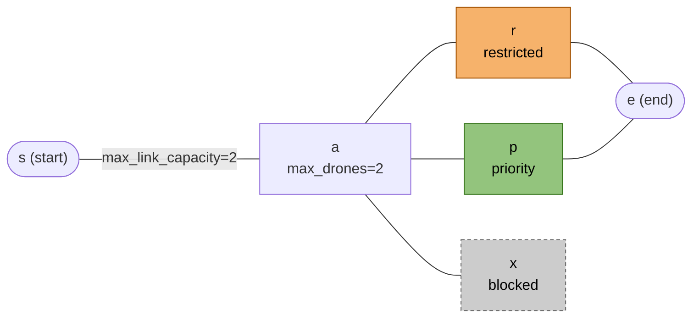

- 端が丸い箱は start と end、四角い箱はそのほかのゾーンです。
- 橙は restricted、緑は priority、灰色の点線は blocked です。箱の 2 行目にも書いてあります。
- `max_drones` などのメタデータは箱の 2 行目に、`max_link_capacity` は線のラベルに書いています。書いていなければ既定値です。
- 線は接続です。向きはありません。
- 座標は図に反映していません。左から右へ並べただけです。

[目次に戻る](#toc)

<a id="int_testcase"></a>
## int_testcase

<a id="int_testcase-01"></a>
### [01.txt](int_testcase/01.txt)

| ケース | 期待 |
|---|---|
| nb_drones に全角の `５` | (自作。コメントに期待なし) |
| nb_drones に先頭の `+5` |  |
| nb_drones に `1_0` |  |
| nb_drones に先頭のゼロ `05` |  |

<a id="int_testcase-02"></a>
### [02.txt](int_testcase/02.txt)

| ケース | 期待 |
|---|---|
| nb_drones が `0` | 拒否(4 行目) |
| nb_drones が `-2` | 拒否(6 行目) |
| nb_drones が `2.0` | 拒否(8 行目) |
| nb_drones の後ろに余分な値 `5 5` | 拒否(10 行目) |

<a id="int_testcase-03"></a>
### [03.txt](int_testcase/03.txt)

| ケース | 期待 |
|---|---|
| 座標にアラビア・インド数字 `١`(U+0661) | 拒否(6 行目) |
| 座標が `+1` | 判断 |
| 座標が `-0` | 受理(0 として) |
| 座標が指数表記 `1e3` | 拒否(12 行目) |
| 座標が 10 の 30 乗。視覚表示で落ちないか | 受理 |

<a id="int_testcase-04"></a>
### [04.txt](int_testcase/04.txt)

| ケース | 期待 |
|---|---|
| max_drones が上付きの `²`(`isdigit()` は真、`int()` は例外) | 拒否(6 行目) |
| max_drones が 16 進数 `0x2` | 拒否(8 行目) |
| max_drones の値が空 | 拒否(10 行目) |
| max_drones が `+2` | 拒否(12 行目) |

<a id="int_testcase-05"></a>
### [05.txt](int_testcase/05.txt)

| ケース | 期待 |
|---|---|
| max_link_capacity が `-1` | 拒否(8 行目) |
| max_link_capacity が `0` | 拒否(10 行目) |
| max_link_capacity が `2.0` | 拒否(12 行目) |
| max_link_capacity が全角の `２` | 拒否(14 行目) |

[目次に戻る](#toc)

<a id="color_testcase"></a>
## color_testcase

01〜18.txt の地図はすべてこの形です。ゾーン a(17・18.txt は接続 s-a)の色だけを変えています。

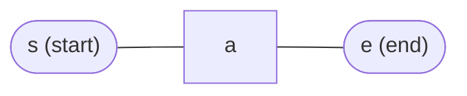

<a id="color_testcase-01-05"></a>
### 配られた地図にある名前、同じ形の名前

| ケース | 期待 |
|---|---|
| [01.txt](color_testcase/01.txt) 8 色に無い名前 `rainbow` | 受理(配られた地図にある) |
| [02.txt](color_testcase/02.txt) 8 色に無い名前 `orange` | 受理(配られた地図にある) |
| [03.txt](color_testcase/03.txt) 8 色に無い名前 `gray` | 受理(配られた地図の名前と同じ形) |
| [04.txt](color_testcase/04.txt) 2 語をつなげた名前 `darkblue` | 受理(配られた地図の名前と同じ形) |
| [05.txt](color_testcase/05.txt) 8 色に無い名前 `purple` | 受理(配られた地図にある) |

<a id="color_testcase-06-10"></a>
### 大文字・ASCII 以外・数字・アンダースコア

| ケース | 期待 |
|---|---|
| [06.txt](color_testcase/06.txt) 大文字 `RED` | 実装依存 |
| [07.txt](color_testcase/07.txt) 大文字と小文字の混在 `Blue` | 実装依存 |
| [08.txt](color_testcase/08.txt) ASCII でない名前 `赤` | 実装依存 |
| [09.txt](color_testcase/09.txt) 数字だけ `123` | 実装依存 |
| [10.txt](color_testcase/10.txt) アンダースコア `dark_blue` | 実装依存 |

<a id="color_testcase-11-16"></a>
### ダッシュ・none・指定なし・`#`・空・2 語

| ケース | 期待 |
|---|---|
| [11.txt](color_testcase/11.txt) ダッシュを含む `red-ish` | 実装依存 |
| [12.txt](color_testcase/12.txt) `none` を明示(PDF の既定値) | 受理 |
| [13.txt](color_testcase/13.txt) 色の指定なし | 受理 |
| [14.txt](color_testcase/14.txt) 16 進の `#ff0000`(`#` はコメントの始まりでもある) | 判断 |
| [15.txt](color_testcase/15.txt) 値が空 `color=` | 判断 |
| [16.txt](color_testcase/16.txt) 2 語 `light blue`(1 語ではない) | 拒否が自然 |

<a id="color_testcase-17-18"></a>
### 接続に色

| ケース | 期待 |
|---|---|
| [17.txt](color_testcase/17.txt) 接続に色 | 判断 |
| [18.txt](color_testcase/18.txt) 接続に色と容量 | 判断 |

<a id="color_testcase-19"></a>
### ログに色の制御文字が混ざらないか

| ケース | 期待 |
|---|---|
| [19.txt](color_testcase/19.txt) PDF 9 ページの例の地図。ログに色の制御文字が混ざらないか | 受理。`cat -A` で `^[[` が出ない |

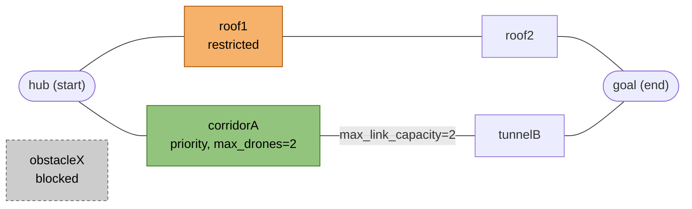

- PDF は色の値を「どんな valid な 1 語の文字列でもよい」とする。配られた地図には `rainbow`・`crimson`・`gold`・`maroon` などがあり、小文字の英単語を拒否すると、配られた地図が動かない。
- 「実装依存」は、valid の範囲(大文字・数字・記号・ASCII 以外)が PDF に無いもの。受理でも拒否でもよいが、落ちないこと。理由を聞く。
- どのケースでも、表示する色(何色で出すか、`RED` を `red` と同じにするか)は実装依存。

[目次に戻る](#toc)

<a id="prove_priority"></a>
## prove_priority

<a id="prove_priority-01-06"></a>
### 5 本の分岐のうち priority が 1〜2 本

どの地図も、start から 5 本の経路(a〜e)が出て end の g に着きます。どの経路も 2 ゾーンで 3 ターンです(04・05.txt は例外があります)。priority の経路は、定義の最初にも最後にも置いていません。定義順で最初か最後の経路を選ぶ実装は、外れます。

| ケース | 期待 |
|---|---|
| [01.txt](prove_priority/01.txt) 同じ 3 ターンの経路が 5 本。c だけ priority | 3 ターン。c1, c2 を通る |
| [02.txt](prove_priority/02.txt) 同じ 3 ターンの経路が 5 本。b と d が priority | 3 ターン。b か d を通る |
| [03.txt](prove_priority/03.txt) 02.txt の地図で 2 台 | 3 ターン。1 台は b、もう 1 台は d を通る |
| [04.txt](prove_priority/04.txt) priority の c だけ 1 ゾーン長い(4 ターン) | 3 ターン。c 以外を通る |
| [05.txt](prove_priority/05.txt) restricted の b(2+1)と priority の c が同点。b を先に定義 | 3 ターン。c1, c2 を通る |
| [06.txt](prove_priority/06.txt) 01.txt の地図で 3 台 | 3 ターン。3 本を使い、そのうち 1 本が c(全員 c だと 5) |

01.txt と 06.txt(台数だけが違う)

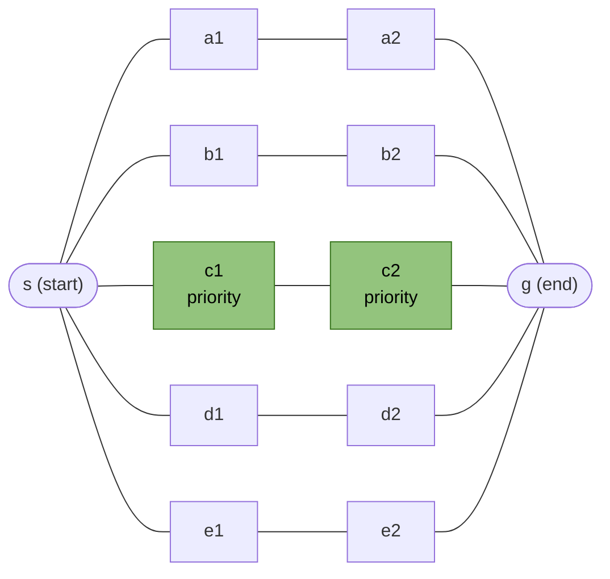

02.txt と 03.txt(台数だけが違う)

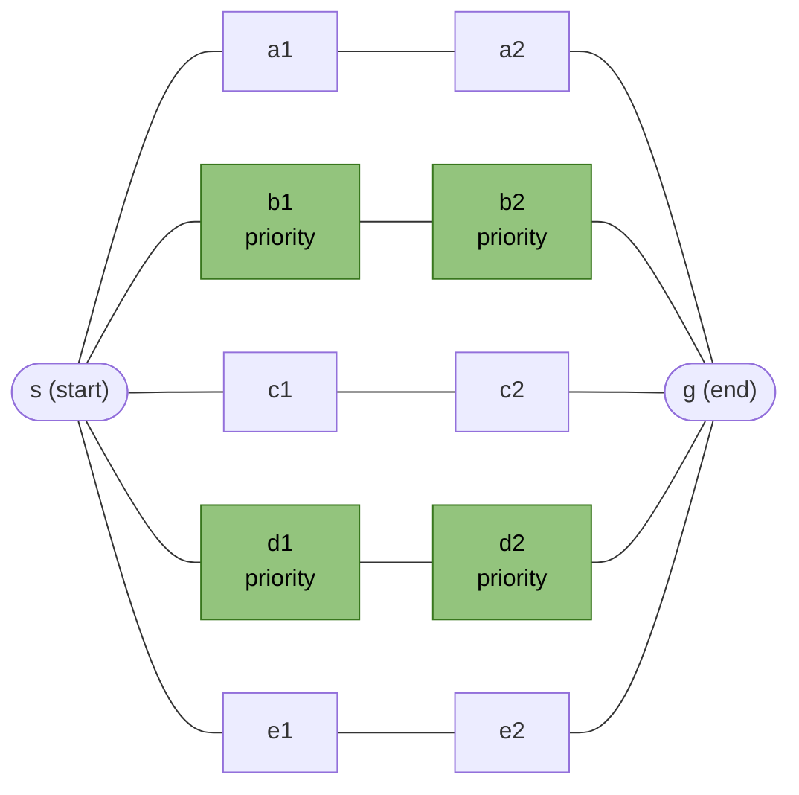

04.txt

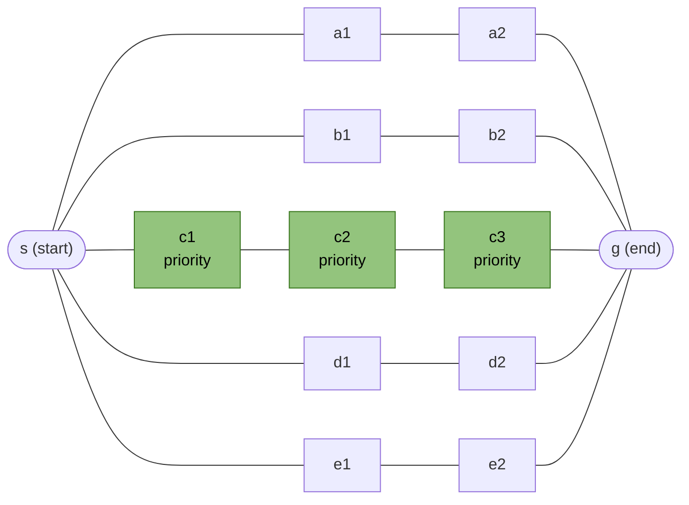

05.txt

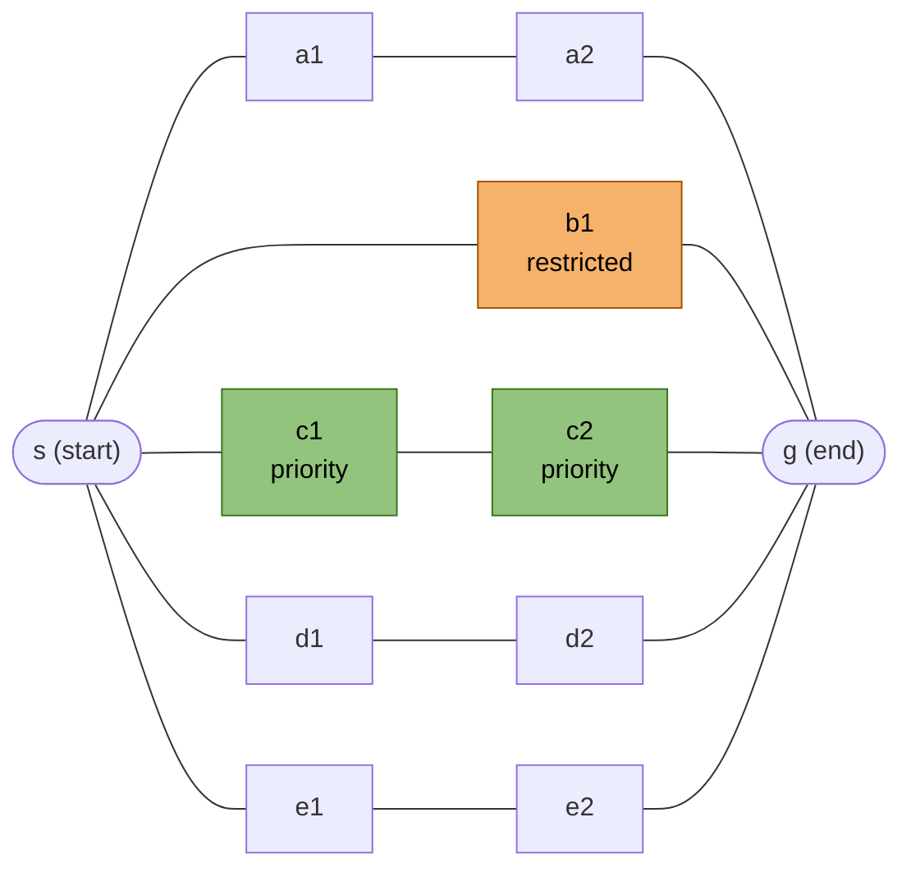

[目次に戻る](#toc)

<a id="prove_restricted"></a>
## prove_restricted

<a id="prove_restricted-01-05"></a>
### 接続の空き方、着く先が満杯、2 つ続く

| ケース | 期待 |
|---|---|
| [01.txt](prove_restricted/01.txt) PDF 13 ページの例(end が restricted、接続の容量 1) | 3 ターン(接続を 2 ターンとも数えると 4) |
| [02.txt](prove_restricted/02.txt) 同じ地図で、接続を `r-s` の向きで書く | 3 ターン。出力が `D1-r-s` か `D1-s-r` かを見る |
| [03.txt](prove_restricted/03.txt) `s - r - e`、3 台 | 5 ターン(2 ターンとも数えると 7) |
| [04.txt](prove_restricted/04.txt) 着く先が満杯なら出発しない | 4 ターン(3 なら r に 2 台で違反) |
| [05.txt](prove_restricted/05.txt) restricted が 2 つ続く | 6 ターン。r1 から r2 は `D<ID>-r1-r2` と出る |

01.txt と 02.txt(接続を書く向きだけが違う)

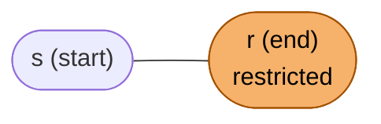

03.txt

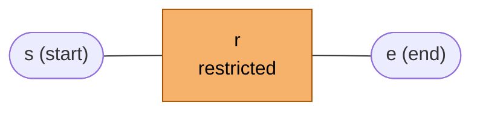

04.txt

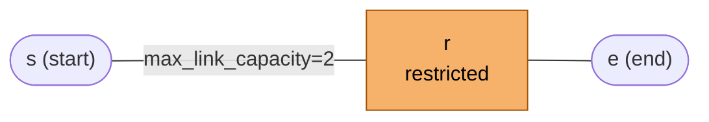

05.txt

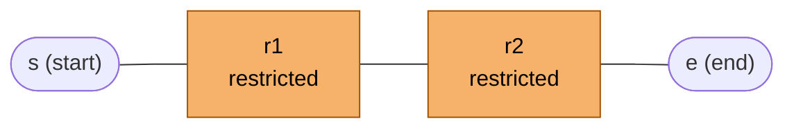

<a id="prove_restricted-06"></a>
### PDF 9 ページの例の地図

| ケース | 期待 |
|---|---|
| [06.txt](prove_restricted/06.txt) PDF 9 ページの例の地図 | 5 ターン(2 ターンとも数えると 6) |


[目次に戻る](#toc)

<a id="prove_follow_through"></a>
## prove_follow_through

<a id="prove_follow_through-01-02"></a>
### 一本道で、出る分が同じターンに空くか

| ケース | 期待 |
|---|---|
| [01.txt](prove_follow_through/01.txt) 出て行くドローンの分は、同じターンで空く | 3 ターン(空かないと 4) |
| [02.txt](prove_follow_through/02.txt) 容量 1 のゾーンが 3 つ続く一本道に 3 台 | 6 ターン(4 + 3 − 1) |

01.txt(2 台)

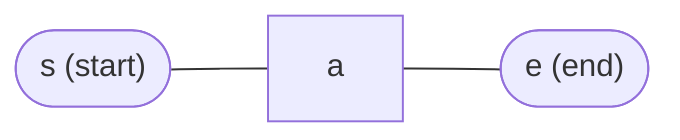

02.txt(3 台)

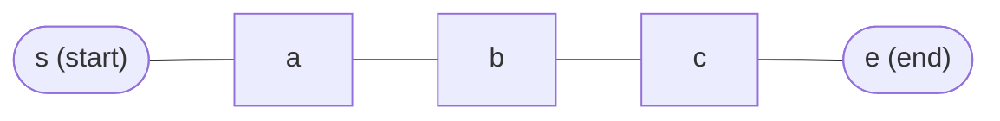

[目次に戻る](#toc)

<a id="prove_capacity"></a>
## prove_capacity

<a id="prove_capacity-01-04"></a>
### 容量の既定値、容量 2、start と end

| ケース | 期待 |
|---|---|
| [01.txt](prove_capacity/01.txt) 接続の容量の既定値は 1(ゾーン a は 2 台入れる) | 3 ターン(無視すると 2) |
| [02.txt](prove_capacity/02.txt) ゾーンの容量の既定値は 1(接続は 2 台通せる) | 3 ターン(無視すると 2) |
| [03.txt](prove_capacity/03.txt) 接続の容量 2 で 4 台 | 3 ターン |
| [04.txt](prove_capacity/04.txt) start と end の容量は無制限 | 2 ターン(end に容量 1 を当てはめると 5) |

01.txt(2 台)

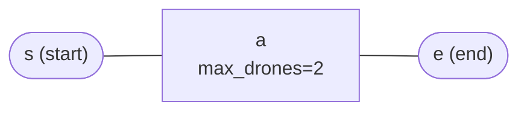

02.txt(2 台)

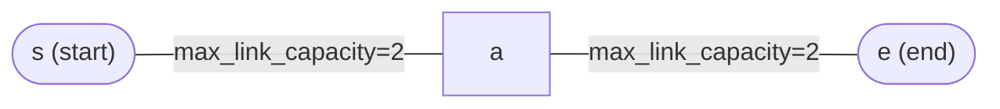

03.txt(4 台)

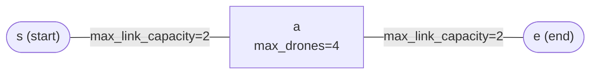

04.txt(5 台)


[目次に戻る](#toc)

<a id="prove_cost"></a>
## prove_cost

<a id="prove_cost-01-03"></a>
### restricted の遠回り・近道、blocked の迂回

| ケース | 期待 |
|---|---|
| [01.txt](prove_cost/01.txt) ゾーンの数では短いが、restricted を 2 つ通るので遅い経路 | 4 ターン。a, b, c を通る(ホップ数の BFS だと 5) |
| [02.txt](prove_cost/02.txt) restricted を通るほうが速い(3 対 4 ターン) | 3 ターン。r を通る |
| [03.txt](prove_cost/03.txt) 最短の経路の途中が blocked | 3 ターン。a, b を通る(2 なら blocked の x に入っている) |

01.txt

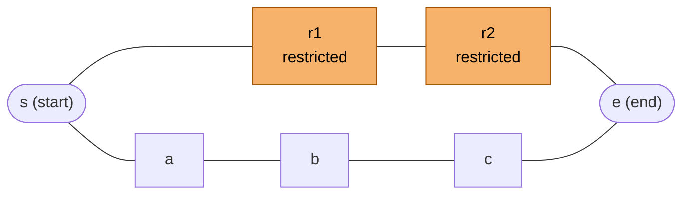

02.txt

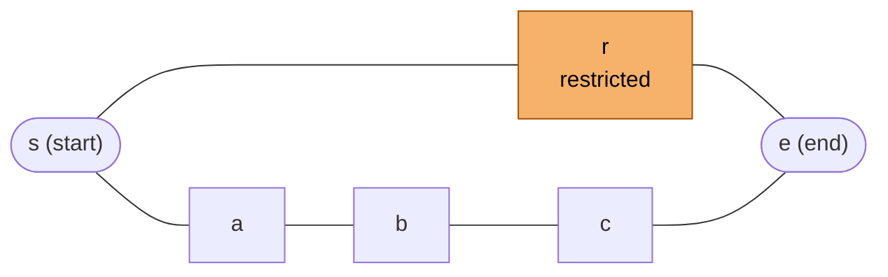

03.txt

```mermaid
graph LR
  s(["s (start)"]) --- x["x<br/>blocked"]:::blocked --- e(["e (end)"])
  s --- a["a"] --- b["b"] --- e
  classDef blocked fill:#cccccc,stroke:#666,color:#000,stroke-dasharray:4 3
```

[目次に戻る](#toc)

<a id="prove_unreachable"></a>
## prove_unreachable

<a id="prove_unreachable-01-05"></a>
### 行けない地図、start や end が blocked

| ケース | 期待 |
|---|---|
| [01.txt](prove_unreachable/01.txt) end へつながる接続が無い | パースのエラーとは別の報告で止まる |
| [02.txt](prove_unreachable/02.txt) 唯一の経路の途中が blocked | パースのエラーとは別の報告で止まる |
| [03.txt](prove_unreachable/03.txt) start の周りに輪(s-a-b-s)があり、end は孤立。1000 台 | パースのエラーとは別の報告で止まる |
| [04.txt](prove_unreachable/04.txt) end_hub 自体が blocked | 判断。受理なら「行けない」と報告する |
| [05.txt](prove_unreachable/05.txt) start_hub 自体が blocked | 判断。受理なら 3 ターンか「行けない」 |

01.txt

```mermaid
graph LR
  s(["s (start)"]) --- a["a"]
  e(["e (end)"])
```

02.txt

```mermaid
graph LR
  s(["s (start)"]) --- x["x<br/>blocked"]:::blocked --- e(["e (end)"])
  classDef blocked fill:#cccccc,stroke:#666,color:#000,stroke-dasharray:4 3
```

03.txt(1000 台)

```mermaid
graph LR
  s(["s (start)"]) --- a["a<br/>max_drones=5"] --- b["b<br/>max_drones=5"] --- s
  e(["e (end)"])
```

04.txt

```mermaid
graph LR
  s(["s (start)"]) --- a["a"] --- e(["e (end)<br/>blocked"]):::blocked
  classDef blocked fill:#cccccc,stroke:#666,color:#000,stroke-dasharray:4 3
```

05.txt

```mermaid
graph LR
  s(["s (start)<br/>blocked"]):::blocked --- a["a"] --- e(["e (end)"])
  classDef blocked fill:#cccccc,stroke:#666,color:#000,stroke-dasharray:4 3
```

[目次に戻る](#toc)

<a id="many_drones"></a>
## many_drones

<a id="many_drones-01-03"></a>
### 100・1000・10000 台

| ケース | 期待 |
|---|---|
| [01.txt](many_drones/01.txt) easy/02_simple_fork の地図で 100 台 | 52 ターン |
| [02.txt](many_drones/02.txt) 同じ地図で 1000 台 | 502 ターン前後(推定)。時間が台数に比例して伸びるか |
| [03.txt](many_drones/03.txt) 同じ地図で 10000 台 | 5002 ターン前後(推定) |

01〜03.txt(台数だけが違う)

```mermaid
graph LR
  st(["start (start)"]) ---|"max_link_capacity=2"| junction["junction<br/>max_drones=2"]
  junction --- path_a["path_a"] --- goal(["goal (end)"])
  junction --- path_b["path_b"] --- goal
```

<a id="many_drones-04-05"></a>
### 1 台と 10 億台

| ケース | 期待 |
|---|---|
| [04.txt](many_drones/04.txt) 1 台、start と end が直結 | 1 ターン(`D1-e`) |
| [05.txt](many_drones/05.txt) 10 億台 | Traceback や MemoryError で落ちない |

04〜05.txt(台数だけが違う)

```mermaid
graph LR
  s(["s (start)"]) --- e(["e (end)"])
```

[目次に戻る](#toc)

<a id="no_traceback"></a>
## no_traceback

04・05・07・08.txt の地図はこの形です。01・02・06.txt には地図がありません。03.txt はゾーン名のバイトが壊れているので、図にしていません。

```mermaid
graph LR
  s(["s (start)"]) --- a["a"] --- e(["e (end)"])
```

<a id="no_traceback-01"></a>
### [01.txt](no_traceback/01.txt)

| ケース | 期待 |
|---|---|
| 空のファイル | 拒否 |

<a id="no_traceback-02"></a>
### [02.txt](no_traceback/02.txt)

| ケース | 期待 |
|---|---|
| コメントしか無い | 拒否 |

<a id="no_traceback-03"></a>
### [03.txt](no_traceback/03.txt)

| ケース | 期待 |
|---|---|
| UTF-8 でない(ゾーン名に 0xE9 のバイト) | 拒否 |

<a id="no_traceback-04"></a>
### [04.txt](no_traceback/04.txt)

| ケース | 期待 |
|---|---|
| 先頭に UTF-8 の BOM | 判断 |

<a id="no_traceback-05"></a>
### [05.txt](no_traceback/05.txt)

| ケース | 期待 |
|---|---|
| 改行が CRLF。名前の末尾に `\r` が残らないか | 受理 |

<a id="no_traceback-06"></a>
### [06.txt](no_traceback/06.txt)

| ケース | 期待 |
|---|---|
| NUL を含むバイナリ | 拒否 |

<a id="no_traceback-07"></a>
### [07.txt](no_traceback/07.txt)

| ケース | 期待 |
|---|---|
| 読む権限が無いファイル(`chmod 000` してから渡す) | 拒否 |

<a id="no_traceback-08"></a>
### [08.txt](no_traceback/08.txt)

| ケース | 期待 |
|---|---|
| 最後の行に改行が無い | 受理 |

ここでの「拒否」は、メッセージと 0 以外の終了コードで終わり、Traceback が出ないことです。

[目次に戻る](#toc)

<a id="parse_format"></a>
## parse_format

どのファイルも地図はこの形です。行の書き方だけを変えています(15.txt は a に `max_drones=2`)。

```mermaid
graph LR
  s(["s (start)"]) --- a["a"] --- e(["e (end)"])
```

<a id="parse_format-01-04"></a>
### nb_drones の行

| ケース | 期待 |
|---|---|
| [01.txt](parse_format/01.txt) `nb_drones:2`(コロンの後に空白が無い) | 判断 |
| [02.txt](parse_format/02.txt) `NB_DRONES: 2`(大文字) | 判断 |
| [03.txt](parse_format/03.txt) コロンの後がタブ | 受理 |
| [04.txt](parse_format/04.txt) 行末のコメント | 受理 |

<a id="parse_format-05-10"></a>
### メタデータ

| ケース | 期待 |
|---|---|
| [05.txt](parse_format/05.txt) `[zone = priority]`(`=` の前後に空白) | 判断 |
| [06.txt](parse_format/06.txt) メタデータの中の `#` | 判断 |
| [07.txt](parse_format/07.txt) 座標と `[` の間に空白が無い | 判断 |
| [08.txt](parse_format/08.txt) メタデータの後ろに余分な語 | 拒否(4 行目) |
| [09.txt](parse_format/09.txt) 空のメタデータ `[]` | 判断 |
| [10.txt](parse_format/10.txt) `[Zone=Priority]`(大文字のキーと値) | 判断 |

<a id="parse_format-11-14"></a>
### 接続の行

| ケース | 期待 |
|---|---|
| [11.txt](parse_format/11.txt) `connection: a - e`(ダッシュの前後に空白) | 判断 |
| [12.txt](parse_format/12.txt) 名前の直後にコメント `a-e#x` | 受理 |
| [13.txt](parse_format/13.txt) コロンの後がタブ | 受理 |
| [14.txt](parse_format/14.txt) `Connection:`(大文字) | 判断 |

<a id="parse_format-15"></a>
### 受理すべき書き方の全部入り

| ケース | 期待 |
|---|---|
| [15.txt](parse_format/15.txt) タブ、空行、字下げしたコメント、行末のコメント、ゾーンと接続が交互(全部入り) | 受理 |

<a id="parse_format-16"></a>
### nb_drones が最初の行でない

| ケース | 期待 |
|---|---|
| [16.txt](parse_format/16.txt) nb_drones が最初の行でない | 拒否(2 行目か 3 行目) |

[目次に戻る](#toc)

<a id="undefined_by_pdf"></a>
## undefined_by_pdf

<a id="undefined_by_pdf-01-03"></a>
### キーの誤りと重複、同じ座標

| ケース | 期待 |
|---|---|
| [01.txt](undefined_by_pdf/01.txt) 知らないキー(タイプミス `max_drone`)。無視すると容量 3 の意図が消える | 判断 |
| [02.txt](undefined_by_pdf/02.txt) 同じキーが 2 回。受理なら、どちらの値を使うか | 判断 |
| [03.txt](undefined_by_pdf/03.txt) 同じ座標のゾーンが 2 つ。視覚表示で落ちないか | 受理 |

01〜02.txt(a のメタデータだけが違う)

```mermaid
graph LR
  s(["s (start)"]) --- a["a"] --- e(["e (end)"])
```

03.txt(この図だけ座標を書いています。b はどこにもつながっていません)

```mermaid
graph LR
  s(["s (start)<br/>(0, 0)"]) --- a["a<br/>(1, 0)"] --- e(["e (end)<br/>(2, 0)"])
  b["b<br/>(1, 0)"]
```

<a id="undefined_by_pdf-04-05"></a>
### 自分自身への接続、逆向きの重複

| ケース | 期待 |
|---|---|
| [04.txt](undefined_by_pdf/04.txt) 自分自身への接続 `a-a` | 判断 |
| [05.txt](undefined_by_pdf/05.txt) 同じ接続を逆向きで、メタデータを変えてもう一度 | 拒否(8 行目。PDF: `a-b` と `b-a` は重複) |

04.txt

```mermaid
graph LR
  s(["s (start)"]) --- a["a"] --- e(["e (end)"])
  a --- a
```

05.txt(`a-e` と `e-a` の 2 本)

```mermaid
graph LR
  s(["s (start)"]) --- a["a"] --- e(["e (end)"])
  e ---|"max_link_capacity=2"| a
```

<a id="undefined_by_pdf-06-09"></a>
### start と end の容量 0、restricted

| ケース | 期待 |
|---|---|
| [06.txt](undefined_by_pdf/06.txt) start の `max_drones=0` | 受理(PDF: 無視され、エラーではない) |
| [07.txt](undefined_by_pdf/07.txt) start_hub が restricted | 判断。受理なら 3 ターン |
| [08.txt](undefined_by_pdf/08.txt) end の `max_drones=0` | 受理(PDF: 無視され、エラーではない) |
| [09.txt](undefined_by_pdf/09.txt) end_hub が restricted | 受理。4 ターン |

06.txt

```mermaid
graph LR
  s(["s (start)<br/>max_drones=0"]) --- a["a"] --- e(["e (end)"])
```

07.txt

```mermaid
graph LR
  s(["s (start)<br/>restricted"]):::restricted --- a["a"] --- e(["e (end)"])
  classDef restricted fill:#f6b26b,stroke:#a35200,color:#000
```

08.txt

```mermaid
graph LR
  s(["s (start)"]) --- a["a"] --- e(["e (end)<br/>max_drones=0"])
```

09.txt

```mermaid
graph LR
  s(["s (start)"]) --- a["a"] --- e(["e (end)<br/>restricted"]):::restricted
  classDef restricted fill:#f6b26b,stroke:#a35200,color:#000
```

<a id="undefined_by_pdf-10-12"></a>
### ゾーン名の記号・日本語・D1

| ケース | 期待 |
|---|---|
| [10.txt](undefined_by_pdf/10.txt) ゾーン名に `:`、`[`、`]` | 判断 |
| [11.txt](undefined_by_pdf/11.txt) ASCII でないゾーン名(日本語) | 受理 |
| [12.txt](undefined_by_pdf/12.txt) `D1` という名前のゾーン | 受理。出力は `D1-D1` |

10.txt

```mermaid
graph LR
  s(["s (start)"]) --- ab["a:b"] --- e(["e (end)"])
  s --- x1["x#91;1#93;"] --- e
```

11.txt

```mermaid
graph LR
  dep(["出発 (start)"]) --- mid["中継"] --- arr(["到着 (end)"])
```

12.txt(1 台)

```mermaid
graph LR
  s(["s (start)"]) --- d1["D1"] --- e(["e (end)"])
```

[目次に戻る](#toc)
